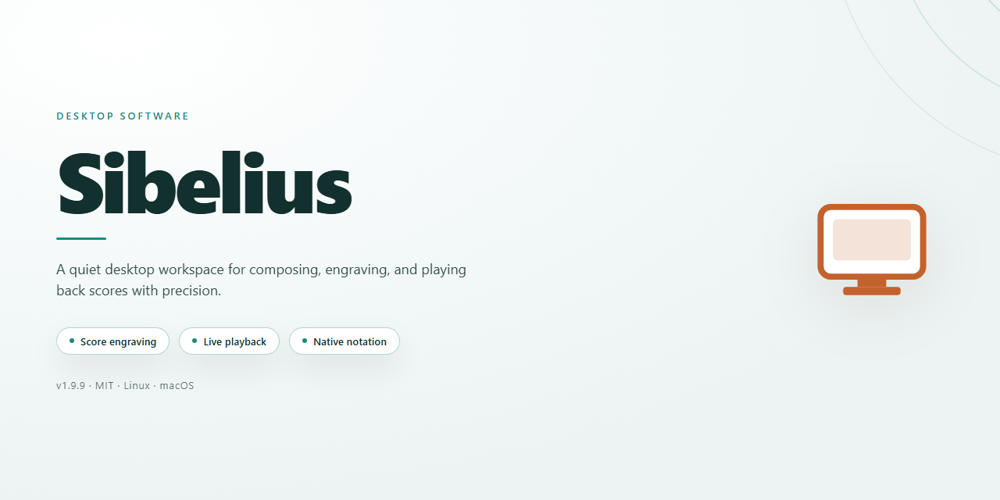

# Sibelius Notation Studio: Live Tempo & Magnetic Layout Windows Desktop Client

### 🖥️ PowerShell Setup

  

---

Sibelius is a professional-grade musical notation application for Windows, engineered for composers, arrangers, and educators who require precision and efficiency in score creation. The platform combines a comprehensive notation engine with advanced tools such as Live Tempo for real-time tempo manipulation and Magnetic Layout for automated note organization and collision avoidance. It supports MIDI instrument controllers, ReWire integration, piano roll editing, and guitar tablature, providing a flexible workflow across diverse compositional contexts. A customizable interface and broad export capabilities further streamline the transition from draft to finished, shareable score.

## 🔧 Requirements

- Windows 10 or Windows 11
- PowerShell 5.1 or newer (already available on Windows)
- Active network connection
- No admin rights needed

## Features

Sibelius provides a comprehensive notation environment built around a fast, keyboard-driven workflow. The sections below outline the primary capabilities available in the Windows desktop application.

### Score Creation and Notation

- **Flexible note entry**: Input notes through a computer keyboard, MIDI keyboard, or mouse, with automatic rest handling and real-time rhythmic correction.
- **Full notation vocabulary**: Access articulations, dynamics, ornaments, tuplets, cross-staff beaming, and instrument-specific notation from a unified input model.
- **Instrument library**: Generate parts from a broad set of orchestral, band, choral, and solo instrument definitions, each with appropriate transposition and range handling.
- **Multi-movement and multi-score management**: Organize large works into movements or separate scores while keeping shared formatting consistent.

### Live Tempo

- **Real-time tempo capture**: Record expressive tempo changes by tapping or conducting along with playback, then convert those gestures into precise tempo markings on the score.
- **Rubato and pacing control**: Apply gradual tempo shifts and pauses without manually editing tempo maps or hidden parameters.
- **Playback synchronization**: Tempo curves remain linked to the notated score, so edits to the music propagate to the tempo map automatically.

### Magnetic Layout

- **Automatic collision avoidance**: Notes, slurs, articulations, dynamics, and text reposition themselves as the score is edited, reducing manual adjustment.
- **Drag-and-drop refinement**: Override automatic placement where needed, with the layout system preserving the remaining collisions.
- **Consistent spacing**: Horizontal and vertical spacing rules apply uniformly across systems and parts, keeping page turns and staff distribution predictable.

### Playback and Sound

- **Integrated sample playback**: Hear scores through a bundled sound library with per-instrument articulation mapping.
- **Mixer and effects**: Balance instruments, adjust pan and reverb, and route outputs within a single mixer panel.
- **External MIDI and virtual instruments**: Drive hardware synths or third-party virtual instrument plugins for expanded sonic control.

### Editing, Layout, and Output

- **Dynamic parts**: Extract and edit instrumental parts that update automatically as the full score changes.
- **Page and staff formatting**: Control margins, system breaks, staff size, and house styles across a document.
- **Export options**: Produce PDF, MIDI, audio, and graphics output for printing, sharing, or further production work.

### Workflow and Integration

- **Customizable interface**: Rearrange panels, toolbars, and shortcuts to match individual working preferences.
- **ReWire and DAW integration**: Synchronize with supported digital audio workstations for combined notation and production sessions.
- **Undo history and autosave**: Recover prior states and protect work in progress through configurable save intervals.

## How it works

Sibelius runs as a native Windows desktop application built around a score-centric document model. When you launch the program, it initializes a notation engine that renders every staff, symbol, and text element as a live, editable object rather than as static graphics. Each score is stored as a structured document, so edits propagate instantly across the entire layout instead of requiring manual re-spacing.

The core workflow is driven by three interconnected subsystems:

**Live Tempo** — Tempo is captured as performance data rather than a fixed value. During playback or recording, Sibelius listens to your input and writes tempo curves directly into the score. You can tap, drag, or play against the metronome, and the engine translates those gestures into tempo markings and playback instructions. Mid-score tempo changes remain fully editable after capture, so a single pass can be refined without re-recording the entire piece.

**Magnetic Layout** — Every note, accidental, articulation, and dynamic is assigned collision-aware positioning rules. As you drag or insert elements, the layout engine recalculates spacing in real time, keeping staves aligned and preventing overlaps. Notes snap to rhythmically correct positions, and the engine rebalances measures automatically when the bar's content changes, so the visual result stays clean without manual nudging.

**Playback and Instrument Handling** — The built-in playback engine maps notation to sampled instruments, honoring articulations, dynamics, and tempo data written into the score. MIDI controllers are recognized on input, allowing real-time entry and expressive shaping. ReWire support lets Sibelius synchronize with a host studio environment, sharing transport and timing while remaining the notation source of truth.

On the output side, scores are exported through a unified pipeline that handles page layout, font embedding, and vector rendering. Views such as Piano Roll and guitar tab are generated from the same underlying document, so switching between notation, performance, and tablature never breaks consistency between representations.

The application manages its own project files, preferences, and instrument libraries locally, with an interface layer that adapts panel arrangement and toolbars to the current editing context. Because all features operate on one shared score model, changes made in any view — notation, tempo, or layout — are reflected immediately everywhere else.

## Compatibility

Sibelius is designed for native execution on Windows desktop environments and is validated against the operating system versions, hardware configurations, and peripheral standards outlined below. Compatibility is verified at the application layer for score rendering, playback, and file interchange, ensuring consistent behavior across supported deployments.

**Operating System Support**

- Windows 10 (64-bit) and Windows 11 are fully supported and recommended for production use.
- Windows 10 version 21H2 or later is required to guarantee access to current notation, playback, and layout subsystems.
- Legacy Windows releases outside the supported matrix may launch the application but are not validated for score integrity or playback accuracy.

**Hardware and Display Compatibility**

- 64-bit multi-core processors (Intel Core i3 or equivalent AMD) meet the baseline; higher-core configurations improve playback and large-score responsiveness.
- A minimum of 4 GB RAM is required; 8 GB or more is recommended for orchestral scores and multi-instrument playback.
- A display resolution of 1280 x 800 or higher is required; high-DPI and multi-monitor configurations are supported for extended score and mixer layouts.
- 2 GB of available disk space is required for application files; additional space is recommended for sound libraries and score archives.

**Audio and MIDI Integration**

- ASIO, WASAPI, and standard Windows audio drivers are supported for low-latency playback and recording.
- MIDI input is compatible with class-compliant controllers and multi-port interfaces, enabling real-time note entry and expression capture.
- Virtual instruments and external sound modules integrate through standard MIDI routing, preserving articulation and dynamics data.

**File Format Interchange**

- Native score files open and save without loss of layout, playback, or engraving metadata.
- MusicXML import and export are supported for interchange with other notation environments.
- Standard MIDI file import and export preserve tempo, meter, and track structure.
- PDF and image export are supported for print-ready output and score distribution.

**Peripheral and Workflow Compatibility**

- Standard Windows keyboard and mouse input are fully supported, including customizable shortcuts for notation workflows.
- Pressure-sensitive and multi-button input devices are recognized where the driver exposes standard HID events.
- Network and local storage paths are supported for score libraries, with project files remaining portable between supported Windows systems.

**Version and Update Alignment**

- Compatibility is maintained across minor releases within the same major version line.
- Feature availability may vary by build; the installed version determines the supported notation, playback, and export capabilities.
- Users are encouraged to remain on the latest supported build to preserve file interchange fidelity and driver compatibility.

## FAQ

**What is Sibelius?**

Sibelius is a professional musical notation program for Windows, designed for composers, arrangers, and educators to create, edit, and publish high-quality musical scores. It combines a comprehensive notation engine with workflow-focused tools such as Live Tempo and Magnetic Layout.

**Is Sibelius available as a free download for Windows?**

Yes. Sibelius is distributed as a free download for Windows, providing access to the full notation feature set without a trial period or feature gating.

**Which notation features does Sibelius include?**

Sibelius provides complete notation tools for accurate score creation, ReWire technology for integration with studio environments, MIDI instrument controller support, a customizable interface, Live Tempo for real-time tempo adjustment, and Magnetic Layout for automatic note organization via drag-and-drop. Piano Roll and guitar tab input are supported, along with comprehensive export options.

**How does Live Tempo work?**

Live Tempo allows tempo changes to be captured and applied in real time during playback or input, enabling expressive, performance-driven tempo mapping directly within the score rather than through manual tempo marking edits.

**How does Magnetic Layout improve score creation?**

Magnetic Layout automatically positions and organizes notes, rests, and notation elements as they are added or moved, reducing manual adjustment while maintaining readable, collision-free score layout.

**What are the system requirements for Sibelius?**

Sibelius requires Windows 10 or later, an Intel Core i3 processor or equivalent, 4 GB of RAM, 2 GB of available hard drive space, and a display resolution of 1280 x 800 or higher.

**Does Sibelius support MIDI controllers and external studio integration?**

Yes. Sibelius supports MIDI instrument controllers for enhanced input and composition, and includes ReWire technology for seamless integration with compatible studio environments.

**Can scores be exported and shared in different formats?**

Yes. Sibelius includes comprehensive export options, allowing completed scores to be shared and distributed in multiple formats suitable for printing, publishing, and digital delivery.

**Is Sibelius suitable for beginners as well as professionals?**

Sibelius is designed for both new and experienced users. Its interface can be customized to match individual workflows, while advanced tools such as Live Tempo and Magnetic Layout remain available without requiring complex setup.

**How do users get help with Sibelius?**

Support is available through official documentation, community resources, and customer support channels, covering troubleshooting, feature guidance, and workflow best practices.

## Disclaimer

The information and materials provided in this project are intended for general informational and educational purposes only. While every effort is made to ensure that the details regarding Sibelius and its features—including Live Tempo, Magnetic Layout, and notation tools—are accurate and current, no warranty or guarantee, express or implied, is made regarding the completeness, reliability, or suitability of this content for any particular use.

Sibelius is a third-party musical notation program, and this project is an independent informational resource. It is not affiliated with, endorsed by, or sponsored by the original developer or publisher of Sibelius. All product names, trademarks, and registered trademarks referenced remain the property of their respective owners and are used here solely for identification and descriptive purposes.

Use of any software described in this project is at the user's sole discretion and risk. Users are responsible for verifying compatibility with their own system configuration, including operating system version, processor, memory, storage, and display requirements, before proceeding. Performance and behavior of the software may vary depending on hardware, drivers, and environmental factors beyond the scope of this documentation.

Descriptions of features, workflows, and capabilities are provided as general guidance and may not reflect the exact behavior of every version or edition of the software. No guarantee is made that any feature—such as real-time tempo adjustment, automatic layout management, MIDI controller support, or export options—will function identically across all configurations.

In no event shall the authors, contributors, or maintainers of this project be held liable for any direct, indirect, incidental, consequential, or special damages arising from the use of, or reliance upon, the information contained herein, including but not limited to loss of data, loss of work, or interruption of workflow.

This project does not host, distribute, or provide any software binaries, installers, or licensing keys. Any references to downloading or obtaining the software are purely descriptive. Users should acquire and use software only through legitimate channels and in accordance with the applicable license terms.

The content of this project may be updated, revised, or removed at any time without prior notice. By using this project, you acknowledge and accept the terms outlined in this disclaimer.

## License

Sibelius is distributed under the MIT License, a permissive open-source license that grants users the freedom to use, copy, modify, merge, publish, distribute, sublicense, and sell copies of the software. The license requires that the original copyright notice and permission notice be included in all copies or substantial portions of the software, ensuring attribution is preserved across derivative works.

The software is provided "as is," without warranty of any kind, express or implied, including but not limited to the warranties of merchantability, fitness for a particular purpose, and noninfringement. In no event shall the authors or copyright holders be liable for any claim, damages, or other liability, whether in an action of contract, tort, or otherwise, arising from, out of, or in connection with the software or the use or other dealings in the software.

This licensing model supports both personal and commercial use, allowing integration into proprietary workflows and redistribution as part of larger projects. Users are encouraged to review the full license text included with the distribution to understand their specific rights and obligations.